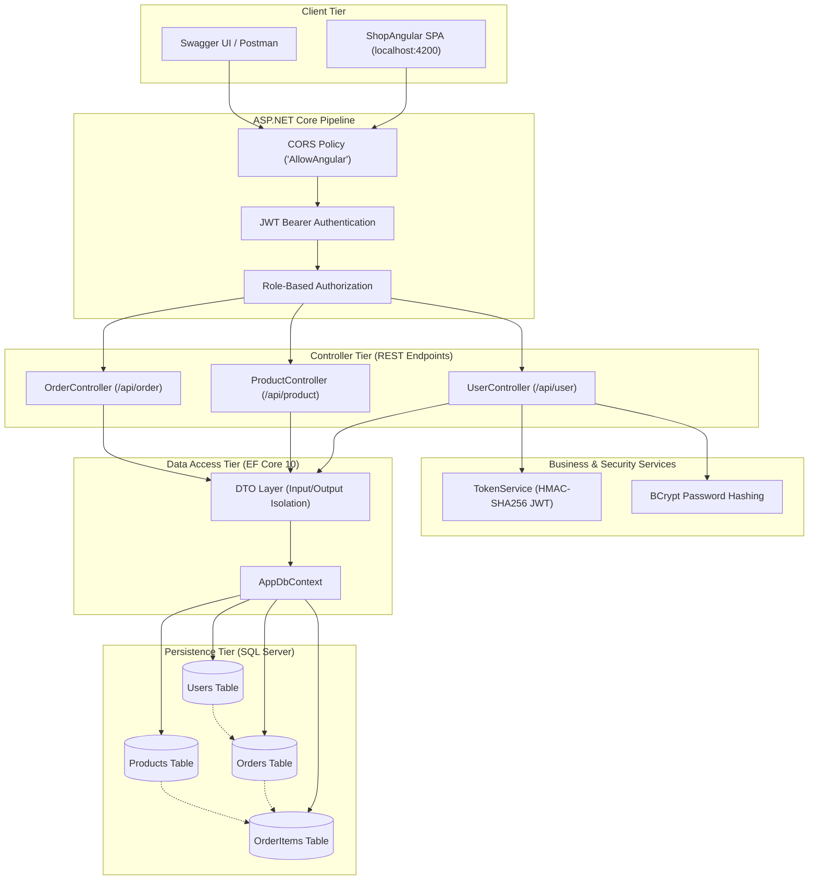

# MyFirstAPI — E-Commerce & Store Management RESTful API

[](https://dotnet.microsoft.com/)
[](https://learn.microsoft.com/dotnet/csharp/)
[](https://learn.microsoft.com/ef/core/)
[](https://jwt.io/)
[](https://swagger.io/)

> A robust, clean-architecture RESTful Web API built on **ASP.NET Core (.NET 10)**. It serves as the e-commerce backend engine, providing secure JWT authentication, role-based access control (RBAC), catalog management, and order processing for web clients (specifically paired with the [ShopAngular](https://github.com/btoan2802/ShopAngular) frontend).

---

## 1. System Architecture

The following diagram illustrates the request lifecycle, security middleware pipeline, service layer, and relational data persistence:



---

## 2. Tech Stack

| Domain | Technologies & Libraries |
| :--- | :--- |
| **Framework** | ASP.NET Core 10.0 (Web API SDK), C# 13 |
| **ORM & Persistence** | Entity Framework Core 10.0 (Code-First), EF Core Migrations |
| **Database** | Microsoft SQL Server (LocalDB / Azure SQL / MSSQL) |
| **Security & Authentication** | JWT Bearer Authentication (`Microsoft.AspNetCore.Authentication.JwtBearer`), HMAC-SHA256 |
| **Password Security** | `BCrypt.Net-Next` (Salted hashing with adaptive work factor) |
| **API Documentation** | OpenAPI 3.0, Swagger UI (`Swashbuckle.AspNetCore 10.3`) |
| **Cross-Origin Policy** | Custom CORS configured for Angular frontend (`http://localhost:4200`) |

---

## 3. Key Engineering Highlights

### 1. Stateless Authentication & JWT Token Architecture
- **Claims-Based Identity**: Emits cryptographically signed JSON Web Tokens containing user claims (`NameIdentifier`, `Name`, `Role`) using HMAC-SHA256.
- **Configurable Expiry & Validation**: Enforces strict validation of token lifetime (2-hour sliding window), Issuer, Audience, and symmetric signing keys.

### 2. Cryptographic Password Protection with BCrypt
- **Salted Hashing**: Replaces legacy plaintext/MD5 storage with `BCrypt.Net-Next`, generating salted hashes that eliminate vulnerability to rainbow table lookups and offline brute-force attacks.

### 3. Role-Based Access Control (RBAC)
- **Granular Protection**: Enforces declarative authorization attributes:
  - Public access: Catalog browsing (`GET /api/product`, `GET /api/product/{id}`).
  - Authenticated customer: Placing orders and reviewing purchase history (`[Authorize]` on `/api/order`).
  - Administrative control: Inventory mutation (`[Authorize(Roles = "Admin")]` for POST, PUT, DELETE products).

### 4. DTO Pattern & Over-Posting Prevention
- **Contract Decoupling**: Database entities (`User`, `Product`, `Order`, `OrderItem`) are decoupled from public HTTP contracts via dedicated DTOs (`RegisterDto`, `LoginDto`, `CreateProductDto`, `CreateOrderDto`, `OrderSummaryDto`).
- Prevents mass assignment/over-posting security vulnerabilities and avoids circular serialization loops during JSON serialization.

### 5. Relational Consistency & Cascade Mapping
- **Normalized Data Architecture**: Encapsulates a multi-table relational schema with foreign key constraints linking `Users` -> `Orders` -> `OrderItems` -> `Products`.
- Computes order totals with quantity validation and product existence guarantees at database write time.

---

## 4. API Endpoints Reference

### 🔐 Authentication (`/api/user`)
| Method | Endpoint | Access | Description |
| :--- | :--- | :--- | :--- |
| `POST` | `/api/user/register` | Public | Register new customer account (hashes password with BCrypt) |
| `POST` | `/api/user/login` | Public | Authenticate user credentials and return signed JWT token |

### 📦 Products (`/api/product`)
| Method | Endpoint | Access | Description |
| :--- | :--- | :--- | :--- |
| `GET` | `/api/product` | Public | Retrieve all available products |
| `GET` | `/api/product/{id}` | Public | Retrieve a specific product by ID |
| `POST` | `/api/product` | Admin | Create a new product in catalog |
| `PUT` | `/api/product/{id}` | Admin | Update existing product details |
| `DELETE` | `/api/product/{id}` | Admin | Remove product from inventory |

### 🛒 Orders (`/api/order`)
| Method | Endpoint | Access | Description |
| :--- | :--- | :--- | :--- |
| `POST` | `/api/order` | Authenticated | Place an order with multiple items (userId extracted from token) |
| `GET` | `/api/order/my-orders` | Authenticated | Retrieve purchase history of authenticated user |

---

## 5. Repository Structure

```
MyFirstAPI/
├── MyFirstAPI/
│   ├── Controllers/            # API Endpoints (OrderController, ProductController, UserController)
│   ├── Data/                   # AppDbContext and Entity Configurations
│   ├── DTOs/                   # Data Transfer Objects (Request/Response models)
│   ├── Migrations/             # EF Core Code-First Migrations history
│   ├── Models/                 # Domain Entities (User, Product, Order, OrderItem)
│   ├── Services/               # TokenService (JWT token builder)
│   ├── Properties/             # launchSettings.json (ports & profiles)
│   ├── wwwroot/                # Static test client interface
│   ├── appsettings.json        # Main configuration (Connection strings, JWT)
│   ├── appsettings.Example.json# Configuration template for developers
│   └── Program.cs              # Dependency Injection & Middleware Pipeline
├── .gitignore                  # Comprehensive .NET gitignore
├── MyFirstAPI.slnx             # Modern Visual Studio solution format
└── README.md                   # Technical documentation
```

---

## 6. Getting Started

### Prerequisites
- [.NET 10 SDK](https://dotnet.microsoft.com/)
- [SQL Server](https://www.microsoft.com/sql-server/) (LocalDB, Express, or Docker container)

### Configuration

1. Review or copy `appsettings.Example.json` into `appsettings.json`:
   ```json
   {
     "ConnectionStrings": {
       "DefaultConnection": "Server=(localdb)\\mssqllocaldb;Database=MyFirstApiDb;Trusted_Connection=True;"
     },
     "Jwt": {
       "Key": "YOUR_SECRET_KEY_AT_LEAST_32_CHARACTERS_LONG_FOR_HMAC_SHA256",
       "Issuer": "MyFirstAPI",
       "Audience": "ShopAngular"
     }
   }
   ```

2. Apply Database Migrations:
   ```bash
   dotnet ef database update --project MyFirstAPI
   ```

3. Run the API:
   ```bash
   dotnet run --project MyFirstAPI
   ```

4. Launch Swagger UI:
   Open browser to `http://localhost:5242/swagger` (or the port defined in `launchSettings.json`).

---

## 7. License & Author

- **Author**: Nguyễn Bảo Toàn ([@btoan2802](https://github.com/btoan2802))
- **Frontend Client**: [ShopAngular](https://github.com/btoan2802/ShopAngular)
- **License**: MIT License

